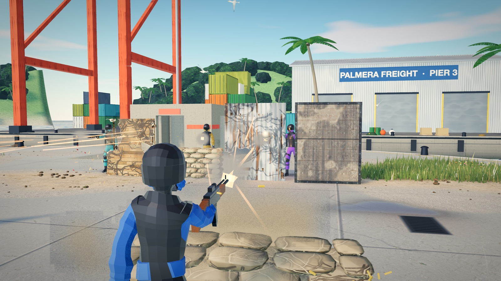
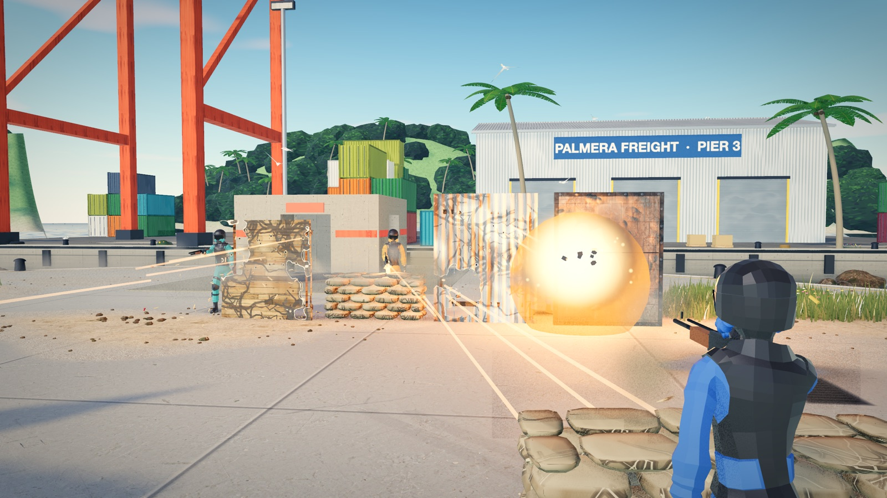
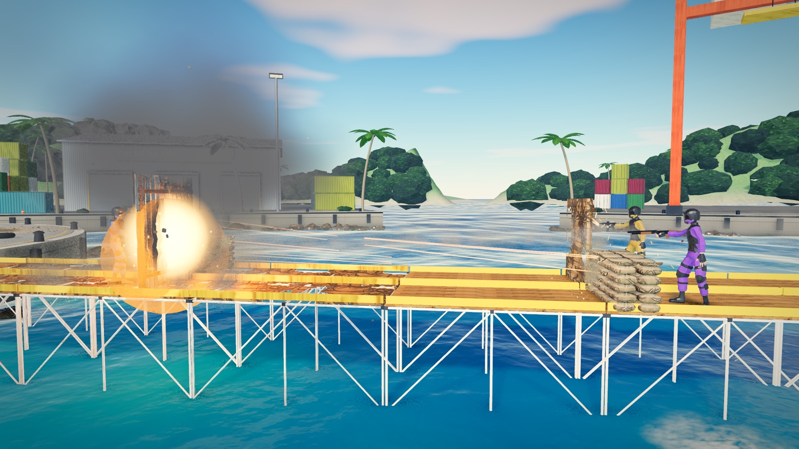
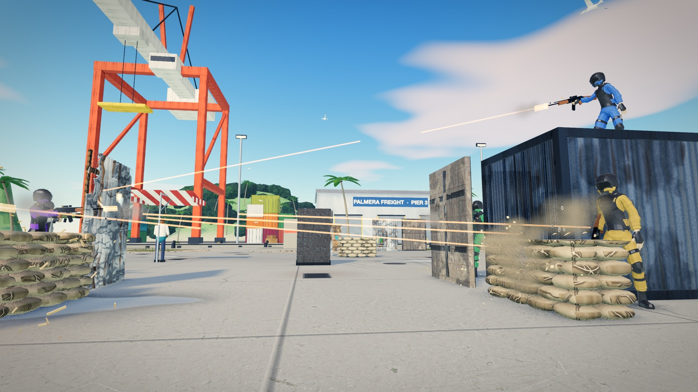
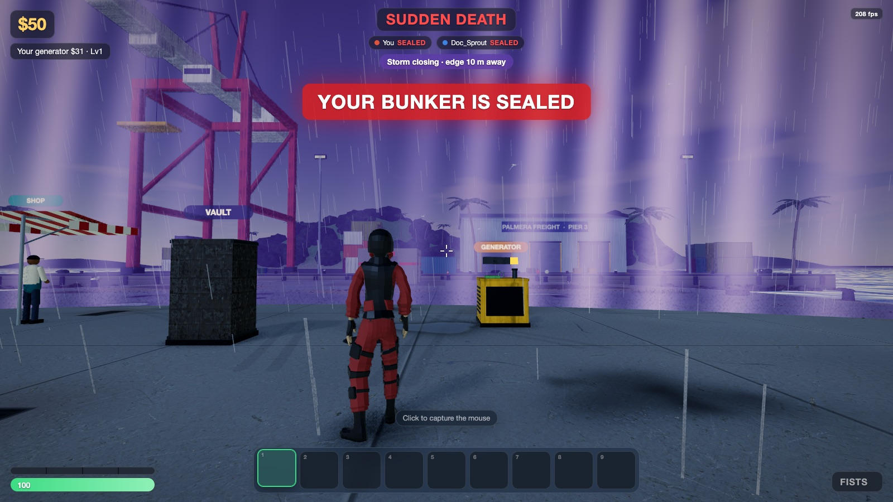
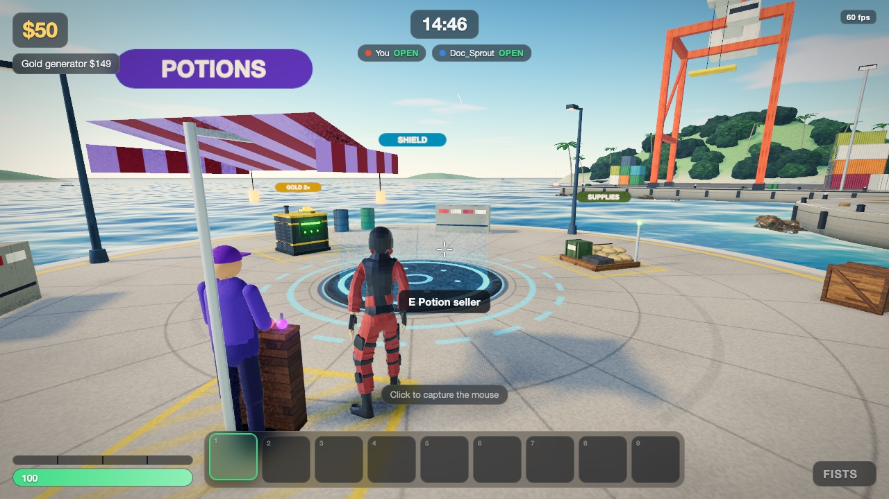
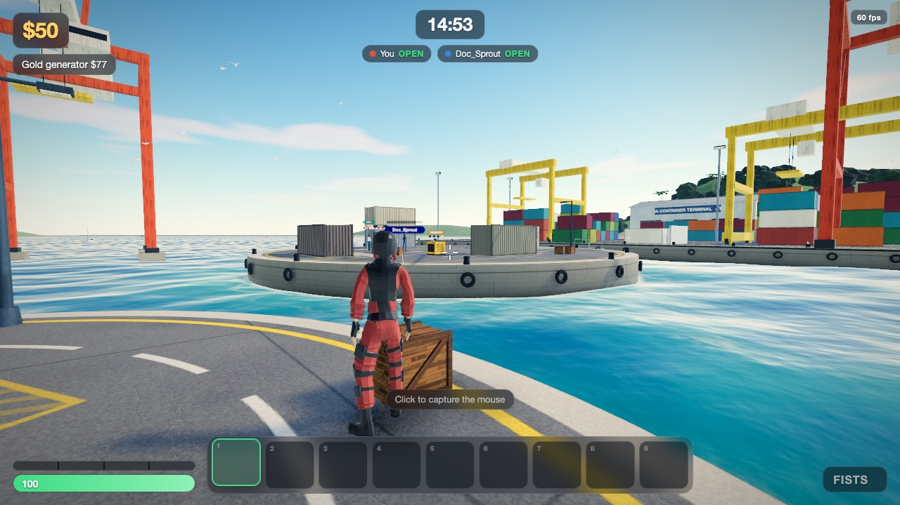
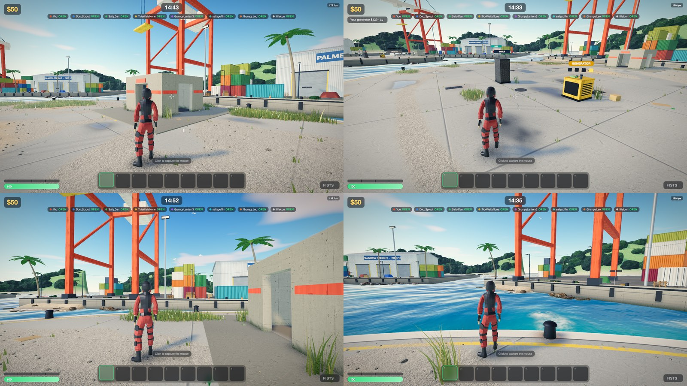

# FAEFight

<p align="center">
  
</p>

**2–8 players, one island each.** Build bridges and walls, push across the water, and seal every enemy bunker before they seal yours. Fights play out on a realistic tropical harbor of cranes, containers, and piers, against friends or bots with their own personalities. Runs in Chrome, no install: **[faefight.vercel.app](https://faefight.vercel.app)**

<table>
  <tr>
    <td width="50%"><br><sub>A rocket slams into a steel wall.</sub></td>
    <td width="50%"><br><sub>Brawling over a scaffold bridge.</sub></td>
  </tr>
  <tr>
    <td width="50%"><br><sub>High ground on a shipping container.</sub></td>
    <td width="50%"><br><sub>Sudden death: the storm closes in.</sub></td>
  </tr>
  <tr>
    <td width="50%"><br><sub>The center island and its shops.</sub></td>
    <td width="50%"><br><sub>A container-yard island across the water.</sub></td>
  </tr>
  <tr>
    <td colspan="2"><br><sub>Around the harbor.</sub></td>
  </tr>
</table>

Third-person island shooter in the browser. Each player starts on their own harbor island. Earn cash, buy guns and walls, bridge over to the enemy, and seal their spawn bunker. A sealed player who dies doesn't respawn. Last one standing wins.

## Run

```bash
pnpm i
pnpm dev        # http://localhost:5173
```

Pick a map and a bot difficulty on the menu, then click the game to capture the mouse.

## Maps

- **Harbor**: the original ring of harbor islands, 36 m apart.
- **Container Yard**: smaller islands 26 m apart, with fixed container stacks as cover and high ground.
- **Random**: a different map than the last one, every match.

Every map has a neutral **center island**, reachable only by bridging to it. Anyone can use its stations: a gold generator (twice the normal rate, up to $1000, first come first served), a supply generator (free sandbags, and now and then a steel plate), a shield well (stand in it to refill shield up to 50) and the potion seller. Built-in cover (containers, concrete barriers) can't be destroyed; barrels, crates, fences, palms, lamps and bollards break when shot or blown up. Each player island has a wooden pier running out toward the island in front of it (a head start on that bridge); rockets, grenades, charges and exploding barrels blow its 2 m sections out, dropping whoever stands there into the sea. Bots do it too, and deck over a blown-out gap when they push.

Every bunker wall has narrow firing slits at chest height: you can shoot and see through them, but nobody (and no grenade or rocket) gets through, and they never count as a way out for sealing.

## Teams

The host picks the **Mode** in the game settings: Free-for-all, **2v2v2v2**, **3v3** or **4v4** (offline vs-bots too).

- **Lobby**: a team mode sizes the lobby (8, 6 or 8 seats). Players pick a team (kept while it has room); everyone else is auto-balanced. Open seats are filled with medium bots at start.
- **Islands**: everyone keeps their own island and bunker; teammates get neighbouring islands, so each team holds one arc of the ring. Each team plays in one colour (red, blue, green, gold) on name tags, the compass, the kill feed, the scoreboard and the islands.
- **Rules**: no friendly fire (bullets, explosions, fire, set-off barrels; blast knockback too). Your own rockets and grenades still hurt you. A teammate's pieces never count toward sealing your bunker, so teammates can't seal each other in. A team is out when all its players are eliminated; the last team standing wins. Storm and sudden death still finish the match.
- **Team info**: teammates are always known: their name tag shows through walls and the compass marks each one with distance.
- **Bots** never shoot teammates or go after their bunkers. They share sightings, focus the same rival (pushing one enemy island together), go help a teammate under fire nearby, and in teams of 3+ one bot stays home as the defender (knobs: `team.*` in `src/sim/bots/params.ts`).
- **Code**: `src/sim/teams.ts` (`isAlly(a, b)` is the one helper every friendly-fire rule uses; true for the same player too).

## Controls

| Key | Action |
|---|---|
| WASD / Shift / Space | Move / sprint / jump |
| Mouse | Aim (click to capture) · LMB fire / place / throw · RMB aim down sights (zoom; rifle 2x scope; Ctrl too, on by default on Mac; hold or toggle in Settings) · R reload |
| 1–9 / wheel | Select hotbar slot: a gun to shoot, a piece to build (click places), a grenade/charge (click throws/places), a medkit (click: +50 HP after 2 s), a potion (click to drink), an empty slot for fists |
| Q / Ctrl+Q (or Shift+Q) | Drop one from the selected slot / drop the whole stack |
| I | Inventory: release the mouse and drag hotbar slots to reorder (I again or click the game to resume) |
| Hold Tab | Scoreboard: kills, deaths, status and bunker state for every player |
| Z / X | Rotate the held piece · hold Alt for free placement |
| E | Collect cash at a generator · open your shop or vault · buy potions at the potion seller |
| V | Toggle first / third person |
| M | Mute / unmute sound |
| P | Cycle graphics quality (low / high / ultra) |
| Enter | Chat |

Every key can be rebound in **Settings → Controls** (main menu or the pause card). Settings (controls, video, audio, gameplay) are stored in `localStorage` under `faefight.settings.v1`.

Shield is the blue bar above health: it takes damage first (falls and water skip it), never regenerates, and is lost on death. Potions are sold only by the potion seller, never at your home shop:

| Potion | Price | Drink | Effect |
|---|---|---|---|
| Small shield | $50 | 1 s | +25 shield, only up to 50 |
| Big shield | $100 | 2 s | +50 shield, up to 100 |
| Heal | $60 | 1 s | +40 HP over 4 s |
| Speed | $120 | 1 s | 30% faster for 15 s (one at a time) |

You can't drink a potion that would do nothing.

Guns behave like guns: spread grows as you fire, move or jump and tightens when you aim down sights; recoil climbs your aim and you pull it back down; headshots do double damage; damage falls off with range (the rifle keeps most of it). A reload with rounds left keeps one in the chamber and is quicker than an empty one; the shotgun loads shell by shell (fire to stop early). The $500 rocket launcher fires a slow rocket that blows up on contact: it breaks steel close up, hurts everyone nearby (you too: rocket jumps cost about half your health) and knocks people back.

Bought items go into the first free hotbar slot (9 slots, like Minecraft). With a full hotbar you can only buy more of what you already hold.

Shop **Upgrades** (home shop only, kept for the whole match): **Generator ↑** raises your generator through 4 levels ($150 / $400 / $900 → $8 / $12 / $18 per second, holding up to $700 / $1000 / $1500; raiders collect the bigger pile too). Once you own a gun, its **🔒 Lock** card (4× the gun's price) makes you respawn with that gun, a full mag and one spare mag.


### Spectating and the end of a match

While you're dead (waiting to respawn, or eliminated) you're an invisible spectator — nobody sees you and the simulation ignores your input:

| Key | Action |
|---|---|
| WASD + mouse | Free-fly camera (no collision) |
| Space / C (or Ctrl) | Fly up / down · hold Shift to fly faster |
| 1–9 · click | Follow that living player · cycle to the next one |
| 0 · any move key | Back to free fly |

When the match ends (or you're eliminated) the end screen offers **Spectate** (Esc brings the end screen back). Vs bot: **Play again** restarts with the same difficulty. Online: the host gets **Rematch** (fresh match, same seats and lobby code; a friend who left becomes a bot) and **Back to lobby**; friends see *Waiting for host…* and follow along without rejoining.

  

### Quality of life

- **Invite link**: the lobby's *Copy invite link* gives `…/?join=CODE`; opening it fills the code and focuses your name (a remembered name makes it one click).
- **Reconnect**: if a friend's connection drops (or their tab reloads) mid-match, a bot plays their seat for 20 s; joining the same code from the same tab takes it back (the menu offers it).
- **Death recap**: who killed you, with what, from how far, headshot or not, the damage you took in the last 10 s by source, and what your killer had left.
- **Match summary** on the end screen: kills, deaths, damage, seals, pieces built, cash collected and longest life per player, plus MVP / Builder / Sealer / Sharpshooter.
- **Compass** over the timer: every island (owner's name, SEALED / OUT), your home bunker, the potion seller and the direction you were just shot from.
- **Connection**: online, the scoreboard has a Ping column and the host's tick health; a small warning shows when your link stalls.
- **Pause**: vs bots, Esc stops the simulation (online it only opens the menu).
- **Combat**: low-ammo warning under the crosshair, ammo counts on every gun slot (amber: no spare mags, red: empty), an empty gun reloads by itself; in the shop Shift+click buys 5 of a building piece and **B** / *↻* re-buys the last item.
- **Remembered**: vs-bot difficulty and bot count (1–7), the host's lobby seat layout, the last shop item; camera mode lives in Settings.

## Develop

```bash
pnpm test    # simulation unit tests (Vitest)
pnpm e2e     # browser smoke test (Playwright)
pnpm build   # typecheck + production build
```

- `src/sim/` is the pure TypeScript game simulation (Rapier physics, 30 Hz), with no DOM or Three.js.
- `src/client/` is the Three.js renderer, input and HUD. The simulation runs in a Web Worker.
- Design: `docs/superpowers/specs/2026-11-19-faefight-design.md`

### Netcode and performance

- Online matches are host-authoritative: the host's worker runs the sim, friends get snapshots.
- Snapshots are binary and delta-compressed against the newest one each friend acknowledged (`src/net/wire.ts`), after the anti-cheat interest filter. A friend gets 30 Hz while their stream fits 32 KB/s, else 15 Hz (`src/net/snapRate.ts`).
- Your own movement is predicted and reconciled. Your own shots (flash, tracer, sound, hitmarker when the spread can't miss) show the frame you fire; the host's confirmation doesn't replay them (`src/client/shotPredict.ts`).
- Lag compensation: the host resolves your hitscan shots against where the targets were on your screen, rewinding at most 0.4 s (`src/sim/lagComp.ts`).
- Simulated network for testing: add `&rtt=120&jitter=20&loss=0.02` to a `?net=local` URL (`src/net/netSim.ts`).
- Measurements: `BENCH=1 npx vitest run tests/net --silent=false` (snapshot bytes, host cost, hit registration under latency). For client frame times, run `PERF=1 pnpm e2e tests/e2e/perf.spec.ts`.

## Data capture and auto-improve

Every match played on the deployed site is recorded and uploaded so the bots can learn from it. This is automatic, with no setting to turn it off. The machine running the simulation (the vs-bot player, or the host online) uploads the recording to `/api/replays` when the match ends, or after 60 s if the tab is hidden or the player leaves early. Recordings hold player names and gameplay only: the recorder never logs chat and strips anything chat-like before encoding (`withoutChat`, `src/sim/replay/format.ts`), and no IP or other personal data is stored. Uploads never get in the way of the game: the recording is encoded in the sim worker, the page never decodes it, each upload waits for an idle moment, uploads go one at a time, and anything over 4 MB is dropped. Client errors (uncaught errors, unhandled rejections, worker crashes, WebGPU device loss, sustained long frames) go to `/api/errors`. Both endpoints are Vercel Functions (`api/`) that write to a private Vercel Blob store (`faefight-replays-private`). They are rate limited per IP, capped at 4 MB per replay and 64 KB per error batch, and prune the oldest blobs beyond 800 MB. Local dev and e2e (`localhost`) never upload unless you add `?telemetry=1`.

Recordings use one deterministic recorder (`src/sim/replay/`): the recorder logs exactly what `Match.tick` was given plus out-of-band ops, a binary codec stores it, and `ReplayRunner` re-runs it with state-hash checks and `Match.fork` checkpoints for seeking. The local Replays screen, the uploader and the learning pipeline all read the same `.faereplay` format. If the host leaves mid-match and a guest takes over (host migration), the match is recorded in segments: the old host's recording uploads under the usual partial rules, and the new host records the rest from the checkpoint it restored (the replay carries that checkpoint) and uploads it like any host. Every segment's header has the same `matchId` (segment 0's id), its `segment` index and `startTick`; to stitch, take each segment up to the next one's `startTick`.

`pnpm auto-improve` runs the nightly loop on this Mac (`scripts/auto-improve.ts`). It never trains bots: training is run separately and reads the dataset this loop writes.

1. Downloads new replays and error reports with the admin key (`REPLAY_ADMIN_KEY` in the untracked `.env.local`).
2. Rebuilds the learning dataset from every downloaded replay in `.autoimprove/learning/` (`scripts/autoimprove/learning.ts`): `human-target.json` (the trainer's imitation target), `human-stats.json`, `scenarios.json` (states where a bot lost to a human) and `manifest.json`. It also re-simulates new replays with the sim invariant checker (`src/sim/invariants.ts`).
3. Auto-fix: for up to 3 new bug signatures it writes a failing reproduction test and runs headless Claude Code (`claude -p`) in a fresh git worktree. A fix is merged only if the reproduction test now passes, `pnpm test`, `tsc` and e2e are green, no existing test or auto-improve file is touched, and the diff is under 200 lines. If a fix merged and `main` still passes, it runs `vercel deploy --prod`.
4. Logs the run to `docs/auto-improve-log.md` and `docs/auto-health.md`. It never pushes to a git remote.

It refuses to run unless `main` is checked out with a clean tree, and holds a lock so runs never overlap. It runs at the lowest priority. Logs are in `.autoimprove/logs/`. Flags: `--dry-run` (download and analyze only, commit nothing), `--no-deploy`, `--no-autofix`, `--api <url>`, and `--source <dir>` (read a local folder laid out like the Blob store instead of the API).

**Schedule.** `scripts/launchd/install.sh` installs `~/Library/LaunchAgents/com.faefight.autoimprove.plist`. The job runs at 03:00, or on wake if the Mac was asleep then.

- Check it: `launchctl print gui/$(id -u)/com.faefight.autoimprove`
- Run it now: `launchctl kickstart gui/$(id -u)/com.faefight.autoimprove`
- Disable it: `launchctl bootout gui/$(id -u)/com.faefight.autoimprove && rm ~/Library/LaunchAgents/com.faefight.autoimprove.plist`
