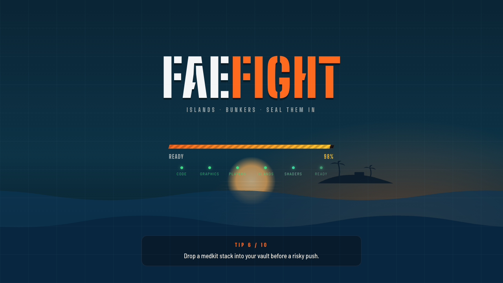
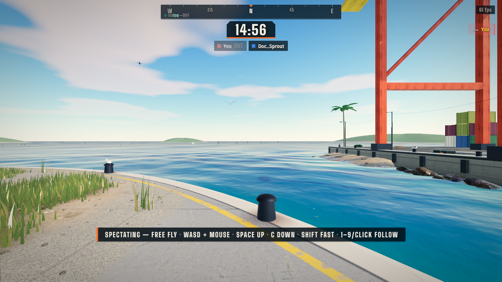
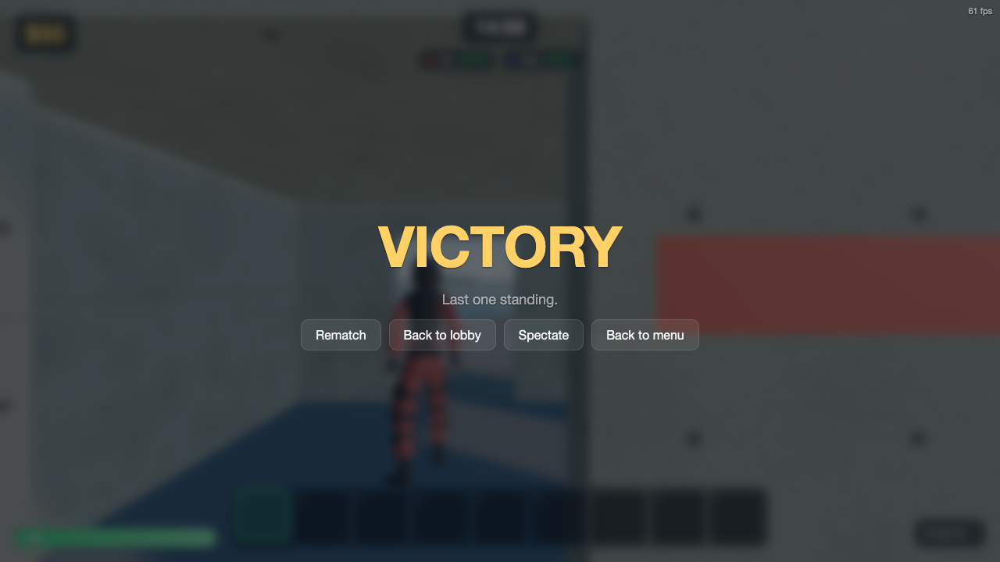

# FAEFight

Third-person island shooter in the browser. Each player starts on their own harbor island. Earn cash, buy guns and walls, bridge over to the enemy, and seal their spawn bunker. A sealed player who dies doesn't respawn. Last one standing wins.

## Run

```bash
pnpm i
pnpm dev        # http://localhost:5173
```

Pick a bot difficulty on the menu, then click the game to capture the mouse.

## Controls

| Key | Action |
|---|---|
| WASD / Shift / Space | Move / sprint / jump |
| Mouse | Aim (click to capture) · LMB fire / place / throw · R reload |
| 1–9 / wheel | Select hotbar slot: a gun to shoot, a piece to build (click places), a grenade/charge (click throws/places), a medkit (click: +50 HP after 2 s), a potion (click to drink), an empty slot for fists |
| Q / Ctrl+Q (or Shift+Q) | Drop one from the selected slot / drop the whole stack |
| I | Inventory: release the mouse and drag hotbar slots to reorder (I again or click the game to resume) |
| Hold Tab | Scoreboard: kills, deaths, status and bunker state for every player |
| Z / X | Rotate the held piece · hold Alt for free placement |
| E | Collect cash at a generator · open your shop or vault · buy potions at the potion seller |
| V | Toggle first / third person |
| M | Mute / unmute sound |
| P | Cycle graphics quality (low / high / ultra) |
| Enter | Chat |

Every key can be rebound in **Settings → Controls** (main menu or the pause card). Settings (controls, video, audio, gameplay) are stored in `localStorage` under `faefight.settings.v1`.

Shield is the blue bar above health: it takes damage first (falls and water skip it), never regenerates, and is lost on death. Potions are sold only by the potion seller, never at your home shop:

| Potion | Price | Drink | Effect |
|---|---|---|---|
| Small shield | $50 | 1 s | +25 shield, only up to 50 |
| Big shield | $100 | 2 s | +50 shield, up to 100 |
| Heal | $60 | 1 s | +40 HP over 4 s |
| Speed | $120 | 1 s | 30% faster for 15 s (one at a time) |

You can't drink a potion that would do nothing.

Bought items go into the first free hotbar slot (9 slots, like Minecraft). With a full hotbar you can only buy more of what you already hold.

### Spectating and the end of a match

While you're dead (waiting to respawn, or eliminated) you're an invisible spectator — nobody sees you and the simulation ignores your input:

| Key | Action |
|---|---|
| WASD + mouse | Free-fly camera (no collision) |
| Space / C (or Ctrl) | Fly up / down · hold Shift to fly faster |
| 1–9 · click | Follow that living player · cycle to the next one |
| 0 · any move key | Back to free fly |

When the match ends (or you're eliminated) the end screen offers **Spectate** (Esc brings the end screen back). Vs bot: **Play again** restarts with the same difficulty. Online: the host gets **Rematch** (fresh match, same seats and lobby code; a friend who left becomes a bot) and **Back to lobby**; friends see *Waiting for host…* and follow along without rejoining.

  

## Develop

```bash
pnpm test    # simulation unit tests (Vitest)
pnpm e2e     # browser smoke test (Playwright)
pnpm build   # typecheck + production build
```

- `src/sim/` is the pure TypeScript game simulation (Rapier physics, 30 Hz), with no DOM or Three.js.
- `src/client/` is the Three.js renderer, input and HUD. The simulation runs in a Web Worker.
- Design: `docs/superpowers/specs/2026-11-19-faefight-design.md`
