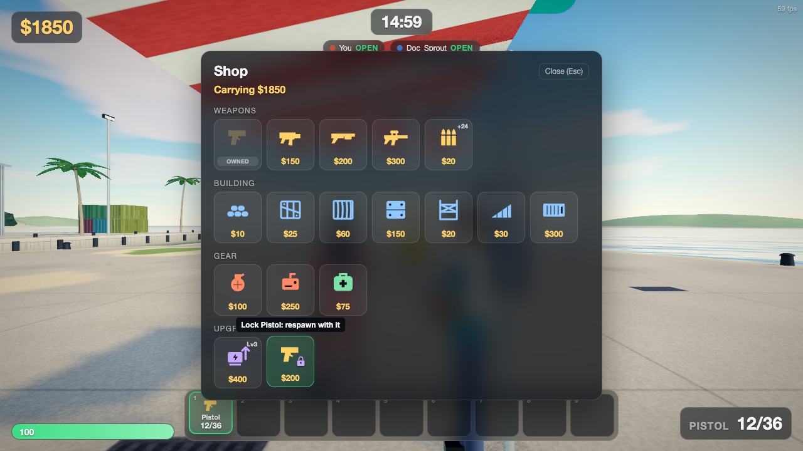

# FAEFight

Third-person island shooter in the browser. Each player starts on their own harbor island. Earn cash, buy guns and walls, bridge over to the enemy, and seal their spawn bunker. A sealed player who dies doesn't respawn. Last one standing wins.

## Run

```bash
pnpm i
pnpm dev        # http://localhost:5173
```

Pick a bot difficulty on the menu, then click the game to capture the mouse.

## Controls

| Key | Action |
|---|---|
| WASD / Shift / Space | Move / sprint / jump |
| Mouse | Aim (click to capture) · LMB fire / place / throw · RMB aim down sights (zoom; rifle 2x scope) · R reload |
| 1–9 / wheel | Select hotbar slot: a gun to shoot, a piece to build (click places), a grenade/charge (click throws/places), a medkit (click: +50 HP after 2 s), a potion (click to drink), an empty slot for fists |
| Q / Ctrl+Q (or Shift+Q) | Drop one from the selected slot / drop the whole stack |
| I | Inventory: release the mouse and drag hotbar slots to reorder (I again or click the game to resume) |
| Hold Tab | Scoreboard: kills, deaths, status and bunker state for every player |
| Z / X | Rotate the held piece · hold Alt for free placement |
| E | Collect cash at a generator · open your shop or vault · buy potions at the potion seller |
| V | Toggle first / third person |
| M | Mute / unmute sound |
| P | Cycle graphics quality (low / high / ultra) |
| Enter | Chat |

Every key can be rebound in **Settings → Controls** (main menu or the pause card). Settings (controls, video, audio, gameplay) are stored in `localStorage` under `faefight.settings.v1`.

Shield is the blue bar above health: it takes damage first (falls and water skip it), never regenerates, and is lost on death. Potions are sold only by the potion seller, never at your home shop:

| Potion | Price | Drink | Effect |
|---|---|---|---|
| Small shield | $50 | 1 s | +25 shield, only up to 50 |
| Big shield | $100 | 2 s | +50 shield, up to 100 |
| Heal | $60 | 1 s | +40 HP over 4 s |
| Speed | $120 | 1 s | 30% faster for 15 s (one at a time) |

You can't drink a potion that would do nothing.

Guns behave like guns: spread grows as you fire, move or jump and tightens when you aim down sights; recoil climbs your aim and you pull it back down; headshots do double damage; damage falls off with range (the rifle keeps most of it). A reload with rounds left keeps one in the chamber and is quicker than an empty one; the shotgun loads shell by shell (fire to stop early). The $500 rocket launcher fires a slow rocket that blows up on contact: it breaks steel close up, hurts everyone nearby (you too: rocket jumps cost about half your health) and knocks people back.

Bought items go into the first free hotbar slot (9 slots, like Minecraft). With a full hotbar you can only buy more of what you already hold.

Shop **Upgrades** (home shop only, kept for the whole match): **Generator ↑** raises your generator through 4 levels ($150 / $400 / $900 → $8 / $12 / $18 per second, holding up to $700 / $1000 / $1500; raiders collect the bigger pile too). Once you own a gun, its **🔒 Lock** card (4× the gun's price) makes you respawn with that gun, a full mag and one spare mag.



### Spectating and the end of a match

While you're dead (waiting to respawn, or eliminated) you're an invisible spectator — nobody sees you and the simulation ignores your input:

| Key | Action |
|---|---|
| WASD + mouse | Free-fly camera (no collision) |
| Space / C (or Ctrl) | Fly up / down · hold Shift to fly faster |
| 1–9 · click | Follow that living player · cycle to the next one |
| 0 · any move key | Back to free fly |

When the match ends (or you're eliminated) the end screen offers **Spectate** (Esc brings the end screen back). Vs bot: **Play again** restarts with the same difficulty. Online: the host gets **Rematch** (fresh match, same seats and lobby code; a friend who left becomes a bot) and **Back to lobby**; friends see *Waiting for host…* and follow along without rejoining.

  

### Quality of life

- **Invite link**: the lobby's *Copy invite link* gives `…/?join=CODE`; opening it fills the code and focuses your name (a remembered name makes it one click).
- **Reconnect**: if a friend's connection drops (or their tab reloads) mid-match, a bot plays their seat for 20 s; joining the same code from the same tab takes it back (the menu offers it).
- **Death recap**: who killed you, with what, from how far, headshot or not, the damage you took in the last 10 s by source, and what your killer had left.
- **Match summary** on the end screen: kills, deaths, damage, seals, pieces built, cash collected and longest life per player, plus MVP / Builder / Sealer / Sharpshooter.
- **Compass** over the timer: every island (owner's name, SEALED / OUT), your home bunker, the potion seller and the direction you were just shot from.
- **Connection**: online, the scoreboard has a Ping column and the host's tick health; a small warning shows when your link stalls.
- **Pause**: vs bots, Esc stops the simulation (online it only opens the menu).
- **Combat**: low-ammo warning under the crosshair, ammo counts on every gun slot (amber: no spare mags, red: empty), an empty gun reloads by itself; in the shop Shift+click buys 5 of a building piece and **B** / *↻* re-buys the last item.
- **Remembered**: vs-bot difficulty and bot count (1–7), the host's lobby seat layout, the last shop item; camera mode lives in Settings.

## Develop

```bash
pnpm test    # simulation unit tests (Vitest)
pnpm e2e     # browser smoke test (Playwright)
pnpm build   # typecheck + production build
```

- `src/sim/` is the pure TypeScript game simulation (Rapier physics, 30 Hz), with no DOM or Three.js.
- `src/client/` is the Three.js renderer, input and HUD. The simulation runs in a Web Worker.
- Design: `docs/superpowers/specs/2026-11-19-faefight-design.md`

### Netcode and performance

- Online matches are host-authoritative: the host's worker runs the sim, friends get snapshots.
- Snapshots are binary and delta-compressed against the newest one each friend acknowledged (`src/net/wire.ts`), after the anti-cheat interest filter. A friend gets 30 Hz while their stream fits 32 KB/s, else 15 Hz (`src/net/snapRate.ts`).
- Your own movement is predicted and reconciled. Your own shots (flash, tracer, sound, hitmarker when the spread can't miss) show the frame you fire; the host's confirmation doesn't replay them (`src/client/shotPredict.ts`).
- Lag compensation: the host resolves your hitscan shots against where the targets were on your screen, rewinding at most 0.4 s (`src/sim/lagComp.ts`).
- Simulated network for testing: add `&rtt=120&jitter=20&loss=0.02` to a `?net=local` URL (`src/net/netSim.ts`).
- Measurements: `BENCH=1 npx vitest run tests/net --silent=false` (snapshot bytes, host cost, hit registration under latency). For client frame times, run `PERF=1 pnpm e2e tests/e2e/perf.spec.ts`.
